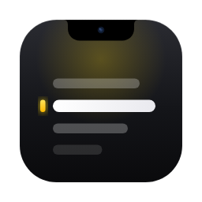
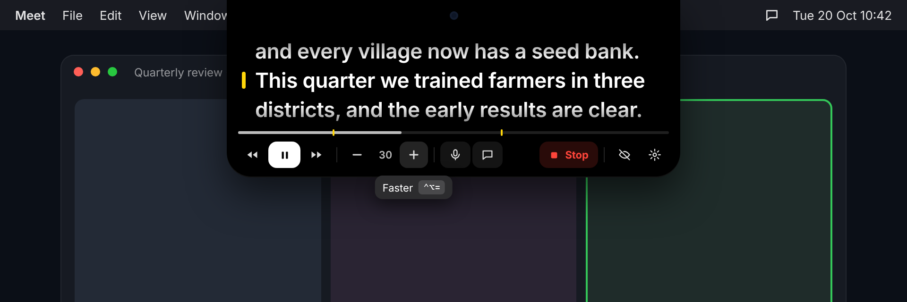
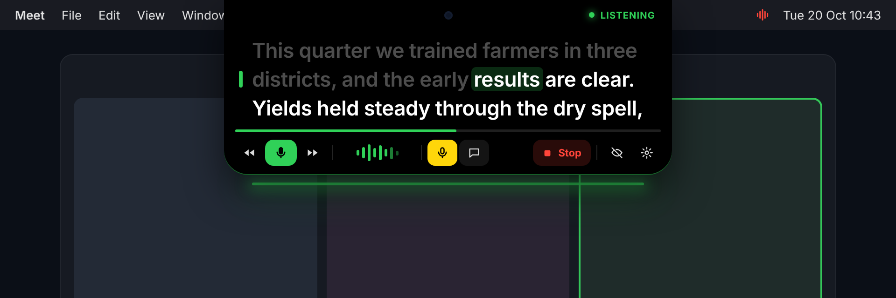
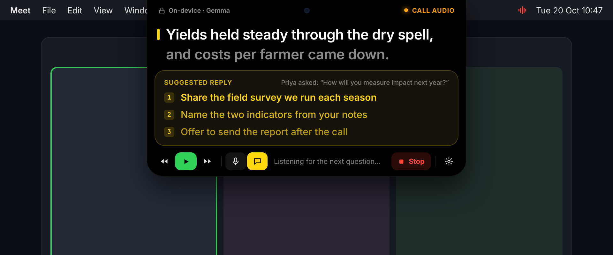
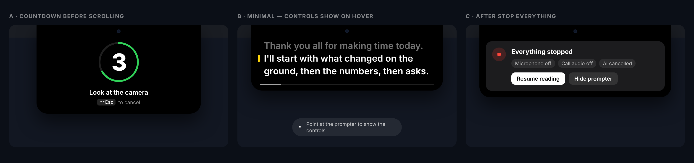
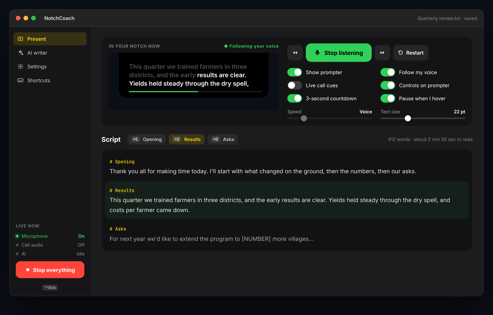
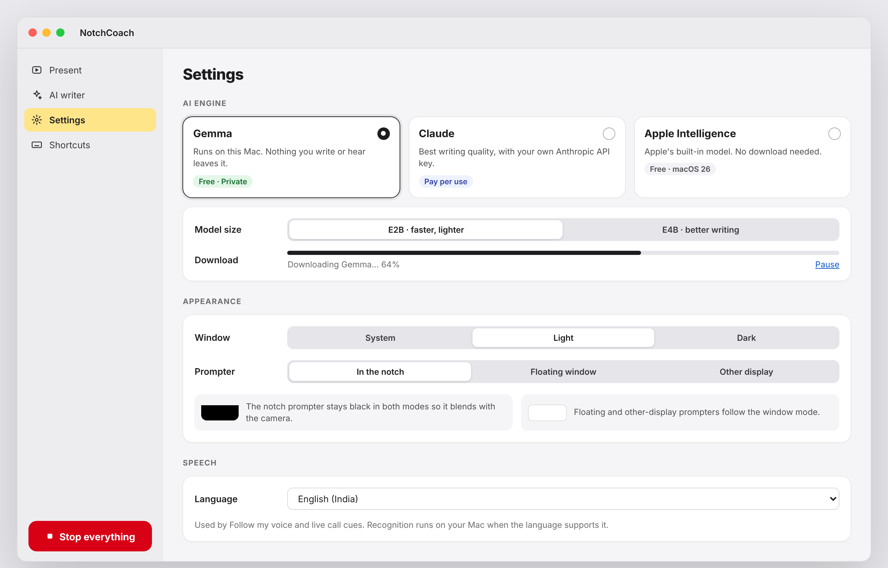

<div align="center">



# NotchCoach

**Read your script. Keep eye contact.**

A free, open-source teleprompter that lives in your MacBook's notch, right under the camera.<br>
It follows your voice, suggests replies on live calls, and runs its AI on your Mac.

[](https://github.com/sandeep9127-hub/notch-prompter-ai/releases/latest/download/NotchCoach.dmg)

[](https://github.com/sandeep9127-hub/notch-prompter-ai/releases/latest)


[](LICENSE)

[Website](https://sandeep9127-hub.github.io/notch-prompter-ai/) · [Download](https://github.com/sandeep9127-hub/notch-prompter-ai/releases/latest) · [Report a problem](https://github.com/sandeep9127-hub/notch-prompter-ai/issues/new/choose)

<br>



<sub>Design preview</sub>

</div>

---

## Why NotchCoach

On a video call, reading notes means looking away from the camera. NotchCoach puts your words a few millimetres from the lens, so you look at people instead of your notes.

- **No account, no subscription, no tracking.** Your script stays on your Mac.
- **Stays out of screen shares and recordings.** Test once with your meeting app.
- **One button stops everything**: scrolling, the microphone, call audio and AI.

## Features

<table>
<tr>
<td width="50%" valign="top">

### Follow my voice
The script moves only as you speak, using Apple's on-device speech recognition. Words you've said fade out and a green glow pulses with your voice. Prefer a steady pace? Auto-scroll at any speed, with a 3-2-1 countdown.

</td>
<td width="50%"></td>
</tr>
<tr>
<td width="50%" valign="top">

### Live call cues
NotchCoach listens to the other side of the call and, when they pause, shows up to three short replies based on your notes. With Gemma or Apple Intelligence it all stays on your Mac.

</td>
<td width="50%"></td>
</tr>
<tr>
<td width="50%" valign="top">

### Always in control
A countdown before you start, a minimal mode that shows controls only on hover, and a clear confirmation after **Stop everything**. The menu bar icon turns red whenever anything is listening.

</td>
<td width="50%"></td>
</tr>
</table>

**Also:** sections you can jump to (start a line with `#`) · notch, floating window or second display · light and dark modes · an AI writer that turns bullet points into a natural script · every action as an on-screen button and a keyboard shortcut.

## Choose where your AI runs

| | Cost | Privacy | Needs |
|---|---|---|---|
| **Gemma** (default) | Free | Everything stays on your Mac | A one-time model download of a few GB |
| **Claude** | Pay per use, your own key | Text goes to Anthropic | An API key from [console.anthropic.com](https://console.anthropic.com) |
| **Apple Intelligence** | Free | Everything stays on your Mac | macOS 26 with Apple Intelligence turned on |

<p align="center">


</p>
<p align="center"><sub>Design previews</sub></p>

## Install

1. Download **[NotchCoach.dmg](https://github.com/sandeep9127-hub/notch-prompter-ai/releases/latest/download/NotchCoach.dmg)**, open it and drag NotchCoach into **Applications**.
2. NotchCoach isn't from the App Store, so macOS asks before opening it. Open it once, then go to **System Settings → Privacy & Security** and click **Open Anyway**. Or run:
   ```sh
   xattr -dr com.apple.quarantine /Applications/NotchCoach.app
   ```
3. Click the NotchCoach logo in the menu bar, paste your script and press play.

**Requirements:** an Apple-silicon Mac (M1 or newer) with macOS 14 Sonoma or later. Macs and displays without a notch can use the floating or second-display mode.

**Permissions:** Follow my voice asks for the Microphone and Speech Recognition. Live call cues ask for Speech Recognition and Screen & System Audio Recording, which is used for call audio only. After granting the recording permission, quit and reopen NotchCoach.

## Keyboard shortcuts

Every shortcut also has a button on the prompter and in the menu bar.

| Keys | Action |
|---|---|
| <kbd>⌃⌥ Space</kbd> | Play / pause, or start / stop listening |
| <kbd>⌃⌥ ↑</kbd> <kbd>⌃⌥ ↓</kbd> | Back / forward one line |
| <kbd>⌃⌥ =</kbd> <kbd>⌃⌥ −</kbd> | Faster / slower |
| <kbd>⌃⌥ 1–9</kbd> | Jump to a section |
| <kbd>⌃⌥ R</kbd> | Restart from the top |
| <kbd>⌃⌥ V</kbd> | Follow my voice on / off |
| <kbd>⌃⌥ C</kbd> | Live call cues on / off |
| <kbd>⌃⌥ H</kbd> | Show / hide the prompter |
| <kbd>⌃⌥ Esc</kbd> | **Stop everything** |

## Privacy

NotchCoach has no account, no analytics and no server. Speech is transcribed live and not saved. Text is sent to an AI service only if you choose Claude. See [PRIVACY.md](PRIVACY.md) for details.

## Troubleshooting

- **Something's stuck:** press <kbd>⌃⌥ Esc</kbd>. If the app doesn't respond, run `killall -9 NotchCoach` in Terminal, or use Activity Monitor → Force Quit. NotchCoach runs from the menu bar, so it doesn't appear in the ⌘⌥Esc Force Quit window.
- **Reporting a problem:** menu bar icon → **Open Log File**, then attach `~/Library/Logs/NotchCoach.log` to a [bug report](https://github.com/sandeep9127-hub/notch-prompter-ai/issues/new/choose).

## Build from source

You need Xcode 26 or later on an Apple-silicon Mac.

```sh
git clone https://github.com/sandeep9127-hub/notch-prompter-ai.git
cd notch-prompter-ai
./scripts/build-app.sh
open build/NotchCoach.app
```

Every push to `main` is built by GitHub Actions and published as a release.

## Contributing

Bug reports, ideas and pull requests are welcome. Please open an issue first for larger changes.

## Licence

[MIT](LICENSE). Gemma models are downloaded from Hugging Face under Google's licence for them. NotchCoach is not affiliated with Apple, Google or Anthropic.
